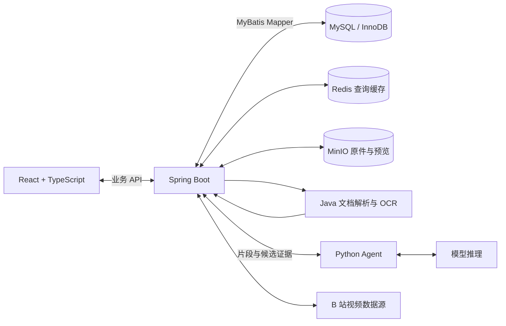

# 个人期末复习助手 · 技术选型与开发规划

首版面向个人 Windows 电脑。React + TypeScript 提供浏览器界面，Java / Spring Boot 承载业务后端，Java 通过 MyBatis 访问 MySQL，MinIO 保存上传原件和预览，Redis 缓存可重建的查询结果。Python 仅用于 Agent。学生把课件、资料和试卷分别放进三个上传区，完成一次分析后，即可从高频知识点点回具体考题和原页。这个“从结论回到证据”的流程是首个可试用版本的交付目标。模型负责识别和关联，程序负责计数，学生进度独立保存。

**文档状态**为架构提案。上述技术栈和语言分工来自用户确认，具体组件、部署方式和模型规格为实施建议。仓库目前包含需求与开发规范，尚无应用代码。三个上传区、按命中题数排序并标注试卷覆盖数、整门课的视频数量与排序、笔记和 Markdown 的边界，沿用 PRD 已核验的决定。下文对解析、归并、复习顺序和运行环境的细化，作为拟议设计随样例验证。[首版 PRD](personal-review-requirements.md) · [知识库核验范围](index.json)

## 一、技术选型

| 环节 | 首选方案 | 选择理由与取舍 |
| --- | --- | --- |
| 用户界面 | React + TypeScript，Vite 构建 | 三个上传区分别维护待提交文件和用途。提交后通过 Spring Boot 查询任务、展示章节和频次、定位原页、保存待办笔记并下载 Markdown。前端类型与后端业务接口契约对齐。[React 的 TypeScript 指南](https://react.dev/learn/typescript) |
| 业务后端 | Java、Spring Boot MVC、MyBatis Spring Boot Starter | 一个 Java 应用内按导入、分析任务、课程知识、复习与视频模块组织。Java 负责文件管理、异步调度、证据校验、统计、学习顺序、笔记、视频检索与导出。通过 Mapper 接口读写 MySQL，在映射 SQL 中汇总题数和试卷覆盖数，Spring 服务层管理事务。MyBatis 底层使用 MySQL JDBC 驱动。[MyBatis 官方文档](https://mybatis.org/mybatis-3/) |
| 业务存储 | MySQL / InnoDB | MySQL 存文件清单、MinIO 对象引用、任务阶段、来源引用、知识点、学习状态和视频结果。分析发布和进度写入使用事务，数据库迁移随 Java 应用交付。[InnoDB 事务模型](https://dev.mysql.com/doc/refman/8.4/en/innodb-transaction-model.html) |
| 文件存储 | MinIO、MinIO Java SDK | Spring Boot 读写私有桶中的原件和预览。原件按内容摘要寻址，预览对象键包含原件摘要和转换配置版本。用户看到上传时的文件名与页码。[MinIO 项目](https://github.com/minio/minio) |
| 查询缓存 | Redis、Spring Data Redis | 按课程 ID 和已发布分析版本缓存章节树与频次。缓存设置有效期；Java 先从 MySQL 确认版本，未命中或 Redis 不可用时直接查询 MySQL。笔记和勾选状态单独读取。[Spring Data Redis](https://docs.spring.io/spring-data/redis/reference/) |
| 解析与定位 | Java、Apache PDFBox、LibreOffice 和 Tesseract 命令行 | Java 调用 LibreOffice 将 PPT/PPTX、DOC/DOCX 转成固定版预览；PDFBox 逐页提取文字、渲染页面。Java 对扫描页或原图调用中英文 OCR，按行直接读取 Markdown。[Apache PDFBox](https://pdfbox.apache.org/) · [LibreOffice 命令行](https://help.libreoffice.org/latest/en-US/text/shared/guide/start_parameters.html) |
| 语义分析 | Python Agent、FastAPI、Pydantic；本机 Ollama 为候选推理服务 | Agent 提议章节、知识点、别名、题目边界与考点关联，并附来源片段 ID。结构化响应返回 Java 校验。用《数据库原理》样例试测 Qwen2.5 7B 的耗时、资源占用及准确率，再确定模型。[FastAPI 请求模型](https://fastapi.tiangolo.com/tutorial/body/) · [Ollama 结构化输出](https://docs.ollama.com/capabilities/structured-outputs) |
| 验证 | JUnit、MySQL、Redis 和 MinIO 集成测试、pytest、React Testing Library、Playwright | Java 验证统计、事务和缓存降级；Python 验证 Agent 输出契约；React 组件测试覆盖交互，浏览器验收覆盖上传、原页回看、笔记和导出。 |

RAG 的首版交付物是带正文和来源的版本化 Markdown。外部应用自行决定如何切块、生成向量和入库。MySQL 中的层级和关联表支持“课程 → 章节 → 知识点 → 证据”的浏览路径。

## 二、运行结构与分析流程

1. **导入。** 每个上传区允许多选与移类，区域决定文件用途。Java 接收文件后检查实际格式和大小，按内容摘要生成对象键，将原件写入 MinIO。对象就绪后通过 MyBatis 登记文件清单。学生提交清单后，Spring Boot 在 MySQL 创建任务，立即返回任务 ID；React 用该 ID 轮询。重复提交相同课程、清单和分析配置时复用任务。
2. **解析与定位。** Java 后台任务从 MinIO 读取原件，按文件生成带标识的片段，并将生成的预览写回 MinIO。PPT/PPTX 保留幻灯片序号，DOC/DOCX 标明固定版预览页，发生重排时补段落锚点。PDF 保留原页序，图片定位到原图，Markdown 保留标题与行号。页序从 1 开始。
3. **按需 OCR。** 对无文本层或明显残缺的页面调用 OCR，混排页面保留原文并核对图区。公式下标、关系代数符号、表格和 E-R 图等存疑区域链接原页。解析失败单独记在该文件，其他文件继续处理。
4. **先建目录，再匹配考题。** Java 按资料类型向 Agent 分批提供片段。先从课件和资料提取章节与概念，再将试卷片段和已有知识点交给 Agent 切题、匹配。Java 校验来源和候选 ID，证据不足的项进入待核对列表，试卷独有的概念可列为待归类。
5. **发布与复习。** Java 以短事务切换 MySQL 的当前分析版本。图谱、频次、复习顺序和导出读取同一版本，首次发布后由 Java 触发视频检索。React 可立即展示复习结果。

**调用契约。** React 仅访问 Spring Boot 的业务 API。上传接口返回文件 ID；创建分析任务接口接收带用途的文件清单，返回 HTTP 202 和任务 ID；查询接口返回阶段、失败文件和已发布版本。章节、知识点详情、试题来源与 Markdown 导出支持指定同一个分析版本。待办与笔记按稳定知识点 ID 单独保存。

Spring Boot 的后台任务通过内部 HTTP 向 Python Agent 提交一次语义处理批次。请求包含契约版本、任务和批次 ID、操作类型、片段 ID 与文本，以及适用的候选知识点 ID。响应回传批次 ID、候选项、证据片段 ID 和待核对原因。Java 校验契约版本、引用归属与批次状态后写入 MySQL。超时按同一批次键有限重试，已采纳批次通过唯一约束去重；耗尽重试后保存失败阶段，界面可发起重试。Agent 仅接收该批必要数据，数据库、缓存和对象存储的应用凭据由 Java 持有。

## 三、核心数据与计算口径

| 数据 | 标识与约束 | 用途 |
| --- | --- | --- |
| 课程、分析版本、任务 | 每次任务固定输入清单、解析器和模型配置版本 | 同一课程串行发布，失败的任务保留错误阶段；读取端始终有明确的分析版本。 |
| 文件、来源片段 | 原件记录包含摘要、桶名与对象键，预览记录关联原件、转换版本及预览对象键。课程清单保存原文件名和用途。每个片段保留文件 ID、页/段/行及片段序号 | 知识说明和命中题都可以回到原件。学生点开原页时，Spring Boot 按课程和文件 ID 查出对象引用，将原件或预览流式返回浏览器，并提供页码或段落锚点。 |
| 章节、知识点、知识点来源 | 知识点首次确认时分配持久 ID，分析版本记录当次名称、章节、别名和出处 | 重新排序或改名均可沿用 ID。新增分析优先匹配已有别名与证据；合并不确定时保留原记录供核对。 |
| 试卷、试题、考点命中 | 试卷 ID 独立于文件 ID，支持一卷多张图片。题目保留题号、父子关系与跨页引用。当前版本内“题目 ID、知识点 ID”唯一 | 同卷相同文件重复导入直接复用。不同扫描件疑似同卷、扫描图分组不明时，供学生确认试卷归属后计入。 |
| 复习状态 | 每个“课程 ID、知识点 ID”保存完成状态、笔记和更新时间 | 重新分析只更新课程知识。已有笔记随知识点保留，暂未匹配的旧知识点保留历史笔记入口。 |
| 视频候选 | 保存视频标识、可选分集标识、标题、链接、三个指标、指标层级、查询时间与状态 | 支持去重、重试、排序和解释缺失值；按课程取推荐结果。 |

**统计。** 从当前版本的有效题目与已采信关联聚合。题数取不同可计数题目 ID 的数量，覆盖数取其不同试卷 ID 的数量，分母取本次纳入的不同试卷数。独立编号且能独立作答的小问作为计数单位；已有可计数子题时排除父题。无可用卷时，界面保留教学知识点并显示“暂无试卷统计”。有有效卷时隐藏零命中项。导出仅收录命中题数大于零的知识点。默认按题数降序，同题数暂用覆盖数、章节序和知识点序打破平局。

**参考顺序。** 先按考查频次得到复习优先级，再把有课程证据支持的基础概念安排在相应考点之前。例如，先复习“函数依赖”和“候选键”，再做高频的“范式判断”。每一步给出对应理由；先修关系冲突或证据不足时沿用章节顺序。待办清单始终使用统计排序。

**导出契约。** 导出服务按课程、章节、知识点生成 Markdown 标题和正文。文档注明格式版本、分析版本和有效卷总数，各知识点列出稳定标识、说明、题数、覆盖卷数及出处。证据含面向用户的文件名和适合原格式的定位。使用 UTF-8，个人笔记和本机绝对路径留在本地；导出测试逐项比对界面使用的统计结果。[PRD 第 6 节与示例](personal-review-requirements.md)

## 四、视频检索的可行性与降级

把“找到相关标题”和“取得可比的热度指标”拆成两步验证。前者可先用限定 B 站视频域名的搜索服务做原型，例如 Brave Web Search；后者须验证目标数据源实际可返回哪些字段、使用条件与更新频率。搜索摘要只能提供候选。前次需求调研直接访问 PRD 的示例视频页返回 HTTP 412，因而程序化获取分集和热度仍是首版风险。[Brave Web Search](https://api-dashboard.search.brave.com/app/documentation/web-search/query) · [B 站示例选集](https://www.bilibili.com/video/BV13T4y1f7dn/)

- 对外查询只发送课程名与优先复习的知识点名。先筛标题相关性；能读取目录时匹配具体一讲并校验链接，否则使用相关的独立视频或整套课程链接。
- 合并重复结果后，整门课合计给出 1～3 个链接。按播放量、点赞数、收藏数依次降序比较，同一指标注明整条视频或分集层级。为避免排序不一致，先对整批同层级候选确定共同可用的指标，再按上述优先级排序。缺失值显示“未取得”；完全无法比较热度时仅按标题相关度展示并说明原因。
- 网络失败或缺少可用来源时保留上次结果及时间，首次失败展示原因和重试入口。验收分别记录链接相关性和热度排序是否在真实数据上成功，模拟数据仅用于验证排序逻辑。

## 五、可靠性与本机部署

- **部署。** 开发时运行 Vite 与 Spring Boot，由 Vite 代理业务 API；个人试用包由 Spring Boot 同源提供 React 构建产物。建议用本机容器启动 MySQL、Redis 和 MinIO，分别为 MySQL 和 MinIO 挂载持久卷。Spring Boot 从本机配置读取私有桶名、服务地址和应用凭据。Java、转换工具和 Python Agent 运行在本机，服务端口绑定回环地址。启动说明列出 JDK、前端构建工具、转换工具、OCR 语言包及模型的实测版本。
- **任务恢复。** Java 从 MySQL 任务表领取任务，记录执行租约和批次检查点。重启后从失效租约处恢复，按文件摘要、配置和模型版本复用已完成产物。Java 仅在执行租约与输入版本仍有效时发布，过期结果无法覆盖新批次。Redis 重启后首次读取从 MySQL 重建缓存。
- **文件与事务。** MinIO 写入成功后才提交可用文件或预览的 MySQL 引用。写入中断时保留可重试状态；对象已写入而数据库提交失败时，重试校验并复用同一对象键。转换工具按需将对象下载至独立临时目录，结束后释放临时文件。转换、OCR、检索与模型调用均在数据库事务之外执行。
- **数据边界。** 本地模型读取必要片段，文件内容作为待分析数据传入。输出只接受约定结构及存在的来源。搜索服务凭据由本机配置注入；日志仅记阶段、耗时、数量与错误类型。测试使用自制或获准公开的资料，个人笔记、上传件、模型文件和运行库保存在仓库外。

## 六、开发顺序与验收

以下按单人开发拆分。各阶段以可演示结果为完成条件；待第一阶段测得试用电脑上的解析和推理耗时，再估算日历工期。

| 阶段与依赖 | 开发内容 | 完成条件 |
| --- | --- | --- |
| M0 可行性验证 | 自制《数据库原理》样例，覆盖各输入格式、中文扫描、混排公式和多分 P 候选。人工标出原页、考点、题号、应待核对项。从 Java 跑通 PDF/OCR 到 Python Agent 的一次调用，固定契约样例，同时验证视频数据源。 | 记录电脑配置、各格式转换情况、页定位一致性、模型耗时和峰值内存、漏配和误配实例、视频实际可得字段。对不可读页能展示原页；据实确定依赖版本、模型规格和可用检索方案。 |
| M1 三个上传区到原页，依赖 M0 的解析结论 | 搭建 React 三个上传区与 Spring Boot 导入 API、MyBatis Mapper、MySQL 迁移、MinIO 上传与预览读取、任务轮询，接入 Java 解析、OCR 和预览。 | 同一批上传三种用途的 PDF，另加入 PPT、DOC 和图片；用途按区域保存。重启存储服务后仍能点回原页，模拟对象写入或元数据提交失败后重试可恢复同一文件引用；单个坏文件不影响其他文件。 |
| M2 章节图谱到真题频次，依赖 M1 | 接入 Python Agent 的章节抽取和题目匹配；Java 归并、校验证据，通过 MyBatis 聚合查询汇总频次，用 Redis 缓存已发布结果。交付第一个完整复习流程。 | 用三份样卷复现“函数依赖 4 题 · 1/3 份卷”排在“关系代数 3 题 · 3/3 份卷”前；均可点回原题。重传同卷计数一致，零次和暂无试卷正确区分。 |
| M3 学习与导出，依赖 M2 | Java 生成复习顺序与 Markdown，React 展示理由、待办与笔记；以稳定 ID 保存学习状态。 | 勾选并写笔记，重启和追加试卷后仍能找到原笔记。打开导出的 Markdown 文档，与界面逐点对照题数和来源；检查独立编号小问及多考点题。 |
| M4 视频推荐，依赖 M0 的数据源验证和 M2 的知识点 | Spring Boot 接入视频数据源，完成单集或分 P 匹配、去重、指标排序和失败重试。可与 M3 并行。 | 有真实候选时，整门课最多 3 条且可打开；有可比指标时按已确认顺序排列。用目录不可读、指标缺失、网络失败三类输入验证降级，主流程可继续。 |
| M5 个人电脑试用，依赖 M3、M4 | 锁定实测依赖、编写启动说明，在 Windows 上用一门完整课程走通导入到导出。 | 逐项复核 PRD 第 7 节。在分析中途重启 Java、模拟 Agent 超时并清空试用 Redis 缓存，确认批次可恢复、无重复计数、旧结果可用、笔记完整；记录运行时间、待核对页及仍受限的视频能力。 |

**首次试用的判据。** 人工标注样例上的题数、覆盖数和来源定位应逐项一致。对额外试卷抽查考点匹配的准确率和召回率，并单列被标为待核对的比例，避免系统靠跳过难题获得虚高指标。待有真实课程样本后确定可接受的质量和耗时阈值。各阶段交付时按仓库规范检查 README 和拟发布文件。[项目编码规范](../coding-standards/README.md)
